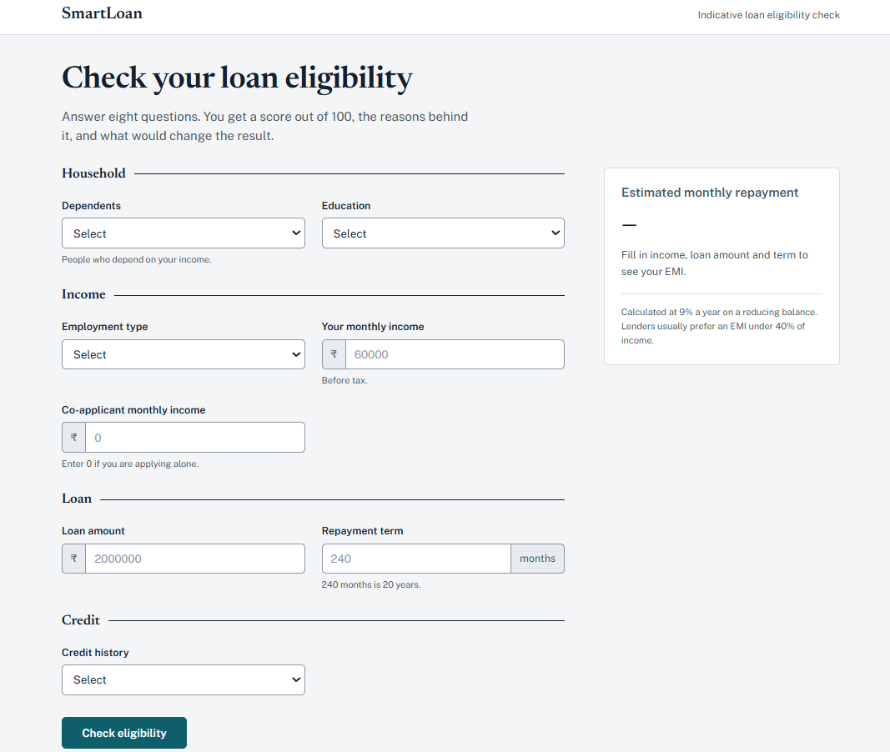
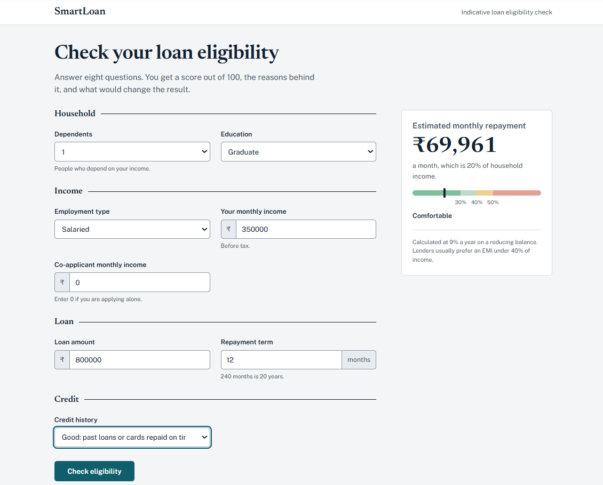
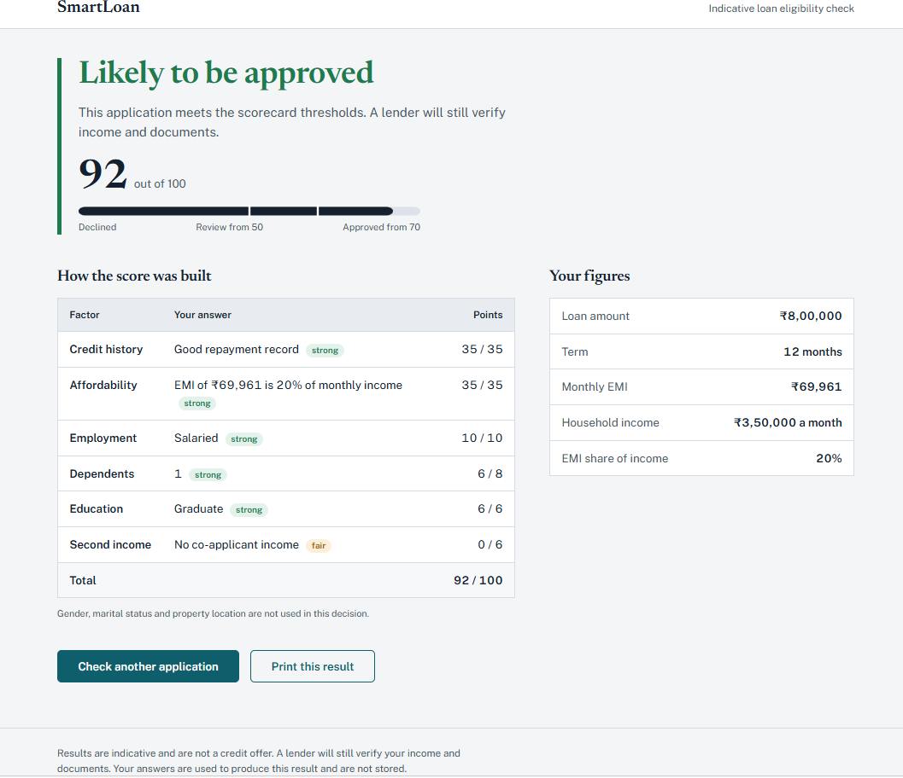

# Explainable Loan Eligibility Scorecard


A credit assessment web application that decides loan eligibility with a transparent scorecard and supports the decision with an optional machine learning model. Every outcome can be explained to the applicant factor by factor.

## Preview



## Overview

Most loan prediction projects return a single label from a black-box model. This project takes a different approach, closer to how lenders actually communicate decisions:

- The decision comes from a rule-based scorecard, not from the model.
- The applicant sees how many points each factor earned and why.
- The applicant gets concrete suggestions for improving the application.
- A trained model is optional and appears only as a secondary approval probability.

## Screenshots

### Checking eligibility



### Assessment results



## Key Features

- 100-point scorecard with a per-factor breakdown
- EMI calculation (reducing balance) and FOIR (EMI as a share of monthly income)
- Three outcomes: approved, review, declined
- Improvement tips, including the loan amount that keeps EMI at 40% of income
- Optional approval probability from Logistic Regression or Random Forest
- Server-side input validation with clear error messages
- Security headers (CSP, X-Frame-Options, nosniff, Referrer-Policy)
- Health endpoint and containerised deployment

## Scorecard Design

| Factor | Max points |
|---|---|
| Credit history | 35 |
| Affordability (FOIR) | 35 |
| Employment type | 10 |
| Dependents | 8 |
| Education | 6 |
| Co-applicant income | 6 |

Decision thresholds:

| Score | Outcome |
|---|---|
| 70 and above | Approved |
| 50 to 69 | Review |
| Below 50 | Declined |

Safeguards that override the score:

- No usable credit history: capped at review
- EMI above 50% of monthly income: capped at review
- EMI above 60% of monthly income: declined

The default annual interest rate is 9% and is configurable.

## Responsible Design

- Gender, marital status and property area are excluded from both the scorecard and the model.
- The model never makes the decision. A missing, corrupt or version-mismatched model file falls back to the scorecard without breaking the app.
- Logs contain only the decision, score and FOIR. No applicant data is logged.

## Machine Learning Component

The optional model is trained on the public Loan Prediction dataset (target: `Loan_Status`).

- Features: dependents, education, self-employed status, applicant income, co-applicant income, loan amount, loan term, credit history
- Candidates: Logistic Regression and Random Forest, with median imputation and class balancing
- Selection: best mean ROC-AUC over 5-fold stratified cross-validation
- Evaluation: held-out 20% stratified test set (accuracy, precision, recall, F1, ROC-AUC, confusion matrix)
- Sanity check: the training script measures how much the model reacts to credit history and warns if the effect is too small
- Output: `models/loan_model.joblib` and `models/loan_model.metrics.json`

## Project Structure

```
loan-eligibility-scorecard/
├── Screenshots/         # README images
├── static/              # Static assets
├── templates/           # HTML templates
├── tests/               # Test suite
├── app.py               # Flask app, validation, routes, security headers
├── scoring.py           # Scorecard, EMI and FOIR logic, decision rules, tips
├── ml.py                # Feature preparation, model loading, probability
├── train_model.py       # Training, model selection, evaluation
├── Dockerfile
├── requirements.txt
└── requirements-dev.txt
```

## Routes

| Route | Method | Purpose |
|---|---|---|
| `/` | GET | Application form |
| `/predict` | POST | Validate input and return the assessment |
| `/health` | GET | Service status and model availability |

## Installation

```bash
git clone https://github.com/Chowdri-Furkhan07/loan-eligibility-scorecard.git
cd loan-eligibility-scorecard
python -m venv venv
source venv/bin/activate        # Windows: venv\Scripts\activate
pip install -r requirements.txt
```

## Usage

Run the app:

```bash
flask --app app run --debug
```

Open http://127.0.0.1:5000. Without a trained model, the app runs on the scorecard alone.

Train the optional model (download the Loan Prediction CSV first):

```bash
python train_model.py --data data/train.csv
```

Retrain whenever the installed scikit-learn version changes, because a model trained with a different version is ignored.

## Configuration

| Variable | Default | Description |
|---|---|---|
| `ANNUAL_INTEREST_RATE` | `9.0` | Rate (%) used for EMI |
| `MODEL_PATH` | `models/loan_model.joblib` | Trained model location |
| `LOG_LEVEL` | `INFO` | Logging level |
| `FLASK_DEBUG` | unset | Set to `1` for debug mode |

## Docker

```bash
docker build -t loan-eligibility-scorecard .
docker run -p 8000:8000 loan-eligibility-scorecard
```

The container runs Gunicorn with 2 workers as a non-root user and includes a health check against `/health`. The app is available at http://localhost:8000.

## Testing

```bash
pip install -r requirements-dev.txt
pytest
```

## Tech Stack

Python 3.11+, Flask, Gunicorn, pandas, NumPy, scikit-learn, joblib, pytest, Docker

## Limitations

- The scorecard weights and thresholds are illustrative, not calibrated on real lending data.
- The optional model depends on a small public dataset.
- This is an educational project and should not be used for real lending decisions.

## Author

Chowdri Furkhan | [GitHub](https://github.com/Chowdri-Furkhan07)
